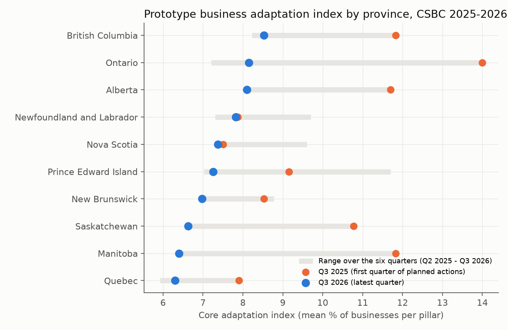
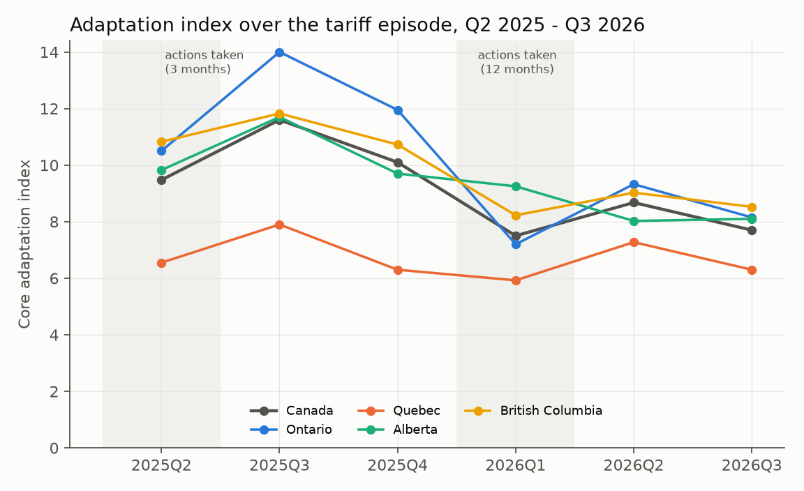
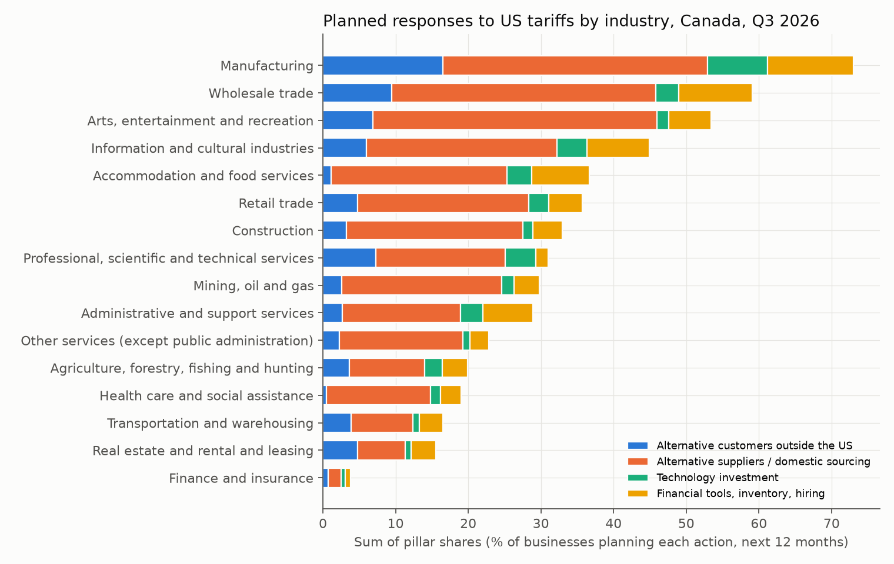
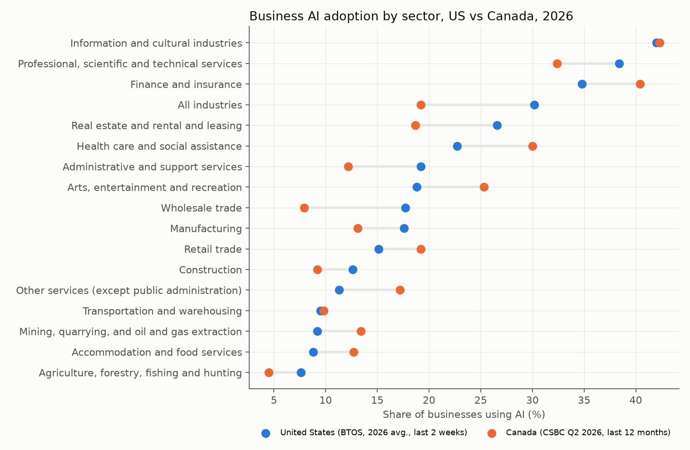
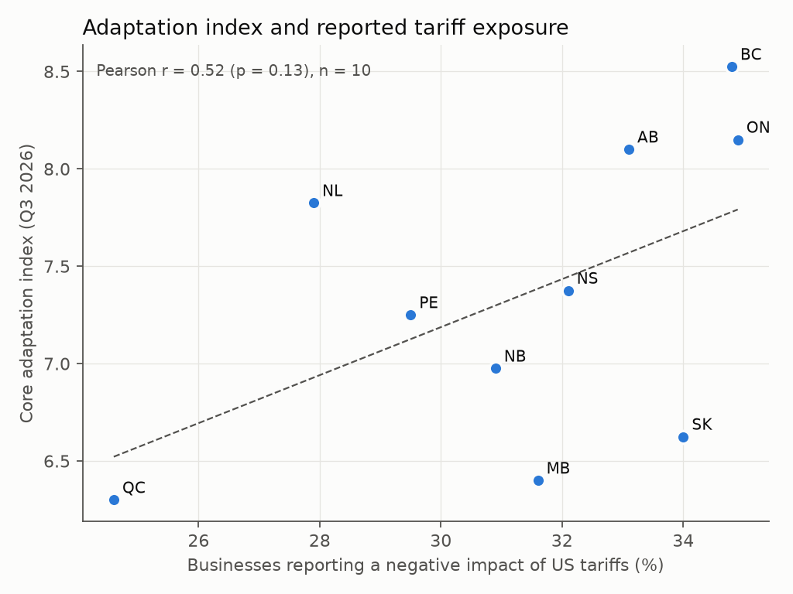
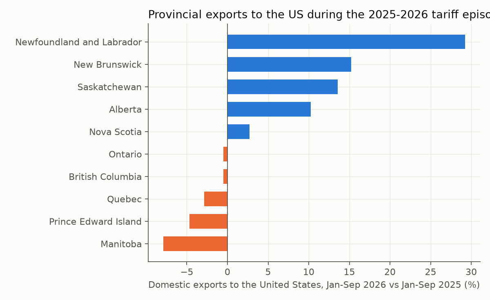

# ADAPT Canada: data-lab starter kit

Prototype data infrastructure for the *Laboratory on adaptation to economic shocks* (Maison des
affaires publiques et internationales, Université de Montréal): how do Canadian businesses adapt
to the US tariff shock and to the rise of AI, and what role do public programs play?

* [Interactive dashboard](dashboard.html)
* [Data inventory and US-Canada crosswalk](01_data_inventory.html)
* [Index methodology](02_methodology.html)
* [Electoral data](03_elections.html)
* [Government programs](04_programs.html)

## First results

All numbers come from public tables; the index is a transparent prototype (see methodology).
Source code and data: the repository's `code/` and `data/processed/` folders.
